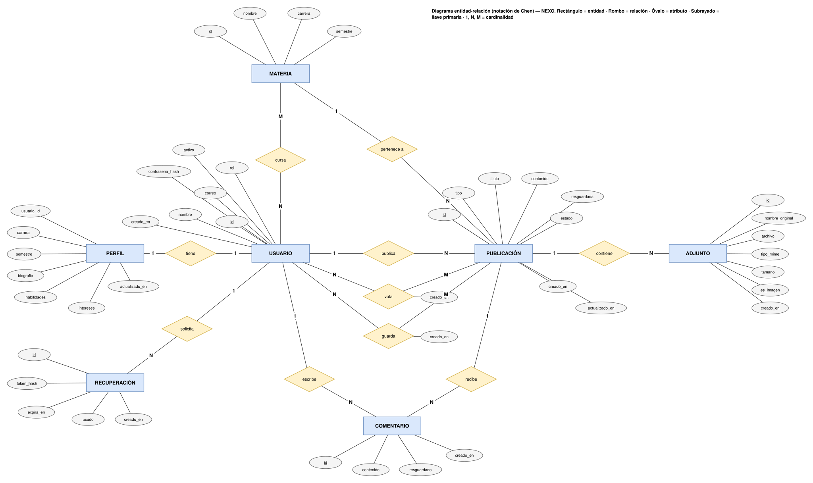
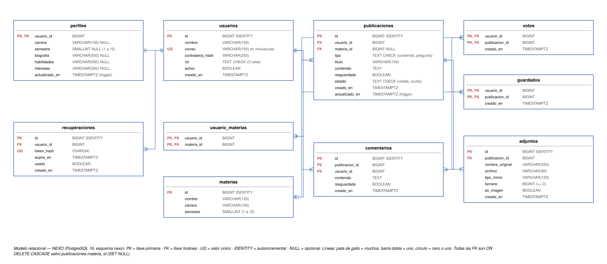

# NEXO_BASE_DE_DATOS

Base de datos de **NEXO: Comunidad estudiantil digital** (TESH) en **PostgreSQL 16**, expuesta en modo lectura con
**PostgREST 12**. La usa el backend **Flask** de la raíz del repositorio (`backend/`): padrón de estudiantes, cuentas,
activaciones, perfiles, materias, publicaciones, adjuntos, respuestas, votos y guardados.

| Carpeta | Contenido |
|---|---|
| [`formularios/`](formularios) | Formularios de gestión 1 a 7 (Word) |
| [`notas/`](notas) | Resumen en TXT de todo el trabajo realizado y pendientes |
| [`docs/`](docs) | Diagramas E-R y relacional, arquitectura de datos y auditoría MySQL → PostgreSQL |
| [`migrations/`](migrations/README.md) | Migraciones de PostgreSQL (V000 a V006) |
| [`scripts/`](scripts/README.md) | Scripts de PowerShell: `.env`, migraciones, conexión, JWT |
| [`tests/`](tests/README.md) | Pruebas de esquema, restricciones, permisos, API y persistencia |
| `docker/postgres/init/` | Creación de roles al iniciar un volumen nuevo |
| `compose.yaml` | Servicios `db` (PostgreSQL), `api` (PostgREST) y `backend` (Flask) |

> El prototipo en PHP de los Sprints 1 y 2 se retiró el 18/11/2026 porque el producto se construye con Flask.
> Sigue disponible en el historial de Git (commit `09433e7`, carpeta `BD/NEXO_BASE_DE_DATOS/nexo/`).

## Arquitectura

```
Navegador ──▶ 127.0.0.1:5000  backend Flask (servicio backend) ──rol nexo_app──▶ db:5432 ─┐
                                                                                          │ red nexo_network
Cliente HTTP ──▶ 127.0.0.1:3000  PostgREST (servicio api) ──rol authenticator──▶ db:5432  PostgreSQL (servicio db)
                 127.0.0.1:3001  /live y /ready                                            volumen nexo_pgdata
Herramientas locales (psql, scripts) ──▶ 127.0.0.1:5432 ───────────────────────────────────┘
```

- **PostgreSQL** guarda todo en el volumen `nexo_pgdata`. Esquemas: `nexo` (tablas), `api` (vistas para PostgREST),
  `nexo_meta` (historial de migraciones).
- **Backend Flask** escribe en PostgreSQL con el rol `nexo_app` por la red interna de Docker.
- **PostgREST** solo publica el esquema `api`. Las tablas de `nexo` nunca se exponen. La API es de solo lectura.
- Los puertos se abren **solo en 127.0.0.1**: nadie de la red puede conectarse.

## Diagramas de la base de datos

Las versiones editables (`.drawio`, se abren en https://app.diagrams.net) están junto a cada imagen en [`docs/`](docs).
Muestran las 10 tablas de V001; las tablas `padron_estudiantes` y `activaciones` de V005 aún no están dibujadas.

**Diagrama entidad-relación** (notación de Chen) — [`diagrama_entidad_relacion.drawio`](docs/diagrama_entidad_relacion.drawio)



**Modelo relacional** (PostgreSQL) — [`modelo_relacional.drawio`](docs/modelo_relacional.drawio)



## Requisitos

- **Docker Desktop** (incluye Docker Compose v2) con WSL2.
- Windows PowerShell 5.1 o PowerShell 7.

## Puesta en marcha

Desde esta carpeta (`BD/NEXO_BASE_DE_DATOS`):

```powershell
# 1. Crear .env con contraseñas aleatorias
powershell -ExecutionPolicy Bypass -File .\scripts\new_env.ps1

# 2. Iniciar PostgreSQL, PostgREST y el backend (la primera vez descarga y construye las imágenes)
docker compose up -d

# 3. Crear las tablas
powershell -ExecutionPolicy Bypass -File .\scripts\apply_migrations.ps1

# 4. Comprobar que todo está listo
powershell -ExecutionPolicy Bypass -File .\scripts\check_connection.ps1
```

La migración V004 avisa a PostgREST (`NOTIFY pgrst`) para que cargue las vistas. Si `/materias` responde 404, recárgalo a mano:

```powershell
docker compose restart api
```

## Variables de entorno

Se definen en `.env` (copia de [`.env.example`](.env.example); `.env` **no** se sube a Git).

| Variable | Uso |
|---|---|
| `POSTGRES_DB` | Nombre de la base (`nexo`) |
| `POSTGRES_SUPERUSER`, `POSTGRES_SUPERUSER_PASSWORD` | Superusuario: solo para crear roles y administrar |
| `NEXO_MIGRATOR_PASSWORD` | Rol `nexo_migrator` (migraciones) |
| `NEXO_APP_PASSWORD` | Rol `nexo_app` (backend Flask) |
| `PGRST_AUTHENTICATOR_PASSWORD` | Rol `authenticator` (conexión de PostgREST) |
| `PGRST_JWT_SECRET` | Firma de los JWT (mínimo 32 caracteres) |
| `NEXO_FLASK_SECRET_KEY`, `NEXO_SESSION_MINUTES` | Sesiones del backend Flask |
| `INSTITUTIONAL_EMAIL_DOMAIN`, `SMTP_*`, `AUTH_DEV_CODE_OUTPUT` | Correo de activación de cuentas |
| `POSTGRES_HOST_PORT`, `POSTGREST_HOST_PORT`, `POSTGREST_ADMIN_HOST_PORT` | Puertos en 127.0.0.1 (5432, 3000, 3001 en `.env.example`) |

Usa solo letras y números en las contraseñas (van dentro de una URL). `new_env.ps1` ya lo hace así.
Las contraseñas de los roles se fijan **la primera vez** que arranca el volumen; cambiarlas después en `.env` no las cambia
en la base (usa `ALTER ROLE ... PASSWORD` como superusuario).

## Roles y permisos

| Rol | Tipo | Puede |
|---|---|---|
| `postgres` | superusuario | Todo. Solo se usa para crear roles, copias de seguridad y las pruebas |
| `nexo_migrator` | LOGIN | Dueño de la base y de los objetos; aplica migraciones |
| `nexo_app` | LOGIN | Lo que el backend necesita: leer/escribir usuarios, padrón, activaciones, perfiles, publicaciones, etc. **No** crea ni borra tablas, **no** borra usuarios, **no** modifica el catálogo, **no** ve el historial |
| `authenticator` | LOGIN NOINHERIT | Solo conectarse y cambiar a `web_anon` o `nexo_lector`; no tiene permisos propios |
| `web_anon` | NOLOGIN | Peticiones sin token: leer `api.materias` |
| `nexo_lector` | NOLOGIN | Peticiones con JWT: leer `api.materias`, `api.publicaciones` y `api.comentarios` |

Roles funcionales de la aplicación (columna `usuarios.rol`, V006): `estudiante`, `moderador` y `administrador`.

Solo `nexo_app` y `authenticator` (además de los dueños) pueden conectarse a la base.
Las vistas de la API no incluyen correos, contraseñas ni adjuntos, solo muestran publicaciones visibles y ocultan al autor
de lo resguardado (`autor = 'Estudiante resguardado'`, `autor_id = null`).

## API (PostgREST)

Base: `http://127.0.0.1:3000`. Formato y filtros de PostgREST (`?select=`, `?materia_id=eq.12`, `?order=`, `?limit=`).

| Endpoint | Sin token | Con JWT `nexo_lector` |
|---|---|---|
| `GET /materias` | 200 | 200 |
| `GET /publicaciones` | 401 | 200 |
| `GET /comentarios` | 401 | 200 |
| `POST`, `PATCH`, `DELETE` | denegado | denegado |
| `GET /usuarios` (y demás tablas) | 404 | 404 |

```powershell
# Catálogo público
Invoke-RestMethod 'http://127.0.0.1:3000/materias?semestre=eq.3&order=nombre'

# Con token (válido 60 minutos)
$token = powershell -ExecutionPolicy Bypass -File .\scripts\new_jwt.ps1 -Role nexo_lector
Invoke-RestMethod 'http://127.0.0.1:3000/publicaciones?tipo=eq.pregunta&order=creado_en.desc&limit=10' `
    -Headers @{ Authorization = "Bearer $token" }
```

**Autenticación:** PostgREST acepta JWT HS256 firmados con `PGRST_JWT_SECRET` cuyo claim `role` sea `nexo_lector`.
Por ahora los genera `scripts/new_jwt.ps1` para pruebas; para usuarios reales, el backend Flask tendría que emitirlos al
iniciar sesión (pendiente). Nunca compartas el secreto: quien lo tiene puede firmar tokens.

## Pruebas

```powershell
powershell -ExecutionPolicy Bypass -File .\tests\run_tests.ps1 -IncluirReinicio   # BD, permisos, API, persistencia
```

Qué valida cada conjunto: [`tests/README.md`](tests/README.md).

## Persistencia y copias de seguridad

- `docker compose stop` / `restart` / `down` **conservan** los datos (volumen `nexo_pgdata`).
- `docker compose down -v` **borra el volumen y todos los datos**. No lo uses salvo que quieras empezar de cero.

```powershell
# Copia de seguridad (formato comprimido de pg_dump)
docker compose exec -T db pg_dump -U postgres -d nexo -Fc -f /tmp/nexo.dump
docker compose cp db:/tmp/nexo.dump .\nexo.dump

# Restaurar en una base vacía
docker compose cp .\nexo.dump db:/tmp/nexo.dump
docker compose exec -T db pg_restore -U postgres -d nexo --clean --if-exists /tmp/nexo.dump
```

Guarda las copias **fuera** del repositorio: contienen datos personales.

## Diagnóstico de errores

| Síntoma | Causa probable y solución |
|---|---|
| `check_connection` dice que Docker no está disponible | Abre Docker Desktop y espera "Engine running" |
| `db` nunca llega a `healthy` | `docker compose logs db`. Si dice "falta la variable", completa `.env` |
| `password authentication failed` | Cambiaste `.env` después de crear el volumen. Usa `ALTER ROLE` o recrea el volumen (borra datos) |
| `Falta el rol ...` al migrar | El volumen se creó sin `01_roles.sh`. Revisa `docker compose logs db` |
| `/ready` responde 503 | PostgREST no se conecta: revisa `PGRST_AUTHENTICATOR_PASSWORD` y `docker compose logs api` |
| La API responde 404 en `/materias` | Las vistas se crearon después de arrancar PostgREST: `docker compose restart api` |
| `/api/health/database` del backend responde 503 | El backend no se conecta: revisa `NEXO_APP_PASSWORD` y `docker compose logs backend` |
| Puerto 5432 ocupado | Cambia `POSTGRES_HOST_PORT` en `.env` |
| Ya tienes otro stack llamado `nexo` en tu PC (por ejemplo, de una copia anterior del proyecto) | Agrega `COMPOSE_PROJECT_NAME=otro_nombre` en `.env` y usa otros puertos; si no, Docker reutiliza el volumen y la base de esa copia |

## Limitaciones conocidas

- La API es de solo lectura y sus tokens se generan a mano; falta que el backend emita JWT por usuario.
- El catálogo de materias es un ejemplo pendiente de validar con el plan de estudios del TESH.
- No hay migraciones "down": se revierte con otra migración o con una copia de seguridad.
- Los `.svg` de los diagramas se generan a partir de los `.drawio`; si se edita un `.drawio`, hay que volver a exportar
  su imagen desde draw.io (Archivo → Exportar como → SVG).
- Los comentarios internos de V001 y V003 mencionan rutas del prototipo PHP (`nexo/docs/`, `nexo/instalar.php`).
  No se corrigen porque editar una migración aplicada cambia su checksum; las rutas actuales son `docs/` y no hay `instalar.php`.
